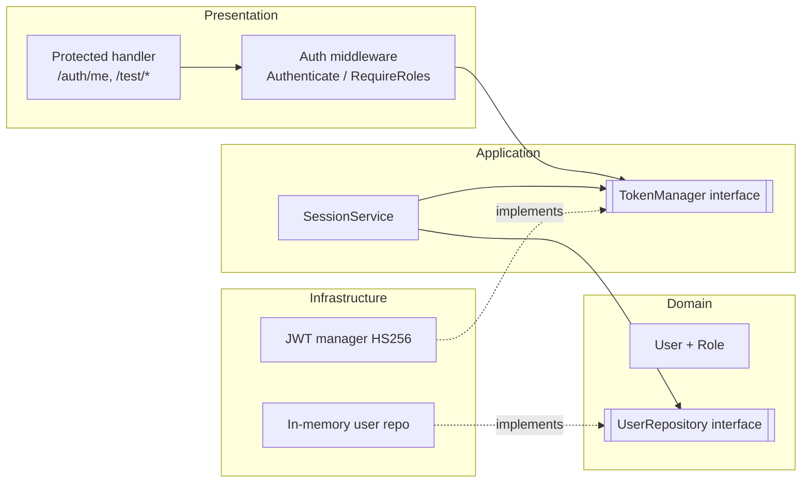
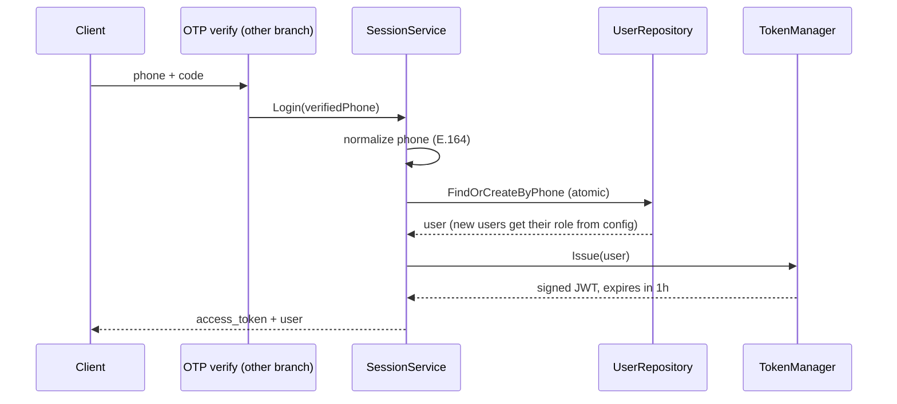
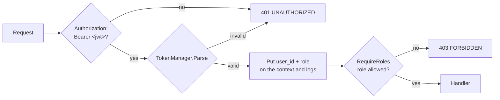

# JWT Authentication & Role-Based Access Control

**Branch:** `feature/jwt-rbac`
**Project:** Too Good To Go: Backend (Go + Gin, Clean Architecture)

---

## The problem

- After a user proves who they are (by OTP), the API needs a **stateless way to recognize them** on every later request.
- Different users must see different things:
  - a **customer** reserves food
  - a **vendor** publishes offers
  - an **admin** manages the platform
- Requirements:
  - Unauthenticated requests are rejected with **401**.
  - Authenticated users with the wrong role are rejected with **403**.
  - Every log line carries the `user_id`.

---

## What this branch delivers

| Area | Delivered |
|---|---|
| Users | `User` model, `Role` enum, user repository (in memory for now) |
| Tokens | HS256 JWT access tokens: issue and verify |
| Login | `SessionService.Login(verifiedPhone)`: find or create the user, then issue a token |
| Access control | `Authenticate` middleware (401) and `RequireRoles` middleware (403) |
| Endpoints | `GET /auth/me` and the per-role test routes `/test/{customer,vendor,admin}` |
| Config | `JWT_SECRET`, `JWT_ISSUER`, `JWT_ACCESS_TTL`, `ADMIN_PHONES`, `VENDOR_PHONES` |

**Not in scope:** checking credentials (that's the OTP branch), refresh tokens, logout, and storing users in Postgres.

---

## Where it sits in the architecture



- Inner layers depend only on **interfaces**.
- Swapping the in-memory repository for Postgres, or HS256 for RS256, doesn't touch the handlers or the services.

---

## Login: turning a verified phone into a session



- `SessionService` **never checks credentials**. It trusts that another factor already verified the phone.
- `FindOrCreateByPhone` is atomic, so two parallel first logins can't create two users.
- **Today:** `SessionService` is built and tested. The `OTP verify → Login` call is the next step.

---

## Token design

| Claim | Value | Purpose |
|---|---|---|
| `sub` | user ID (UUID v4) | who the caller is |
| `role` | `customer` / `vendor` / `admin` | what they may do |
| `iss` | `JWT_ISSUER` | rejects tokens from other systems |
| `iat` | issue time | auditing |
| `exp` | issue time + `JWT_ACCESS_TTL` (1h) | limits the damage of a leaked token |

- **Why HS256:** there's a single service that both issues and verifies tokens, so one shared secret is enough. If other services ever need to verify tokens, we can move to RS256 without changing the `TokenManager` interface.
- **Why stateless:** `/auth/me` answers from the token alone, with no database lookup on every request.

---

## What `Parse` rejects

Every one of these becomes `ErrInvalidToken`, and the API answers **401**:

- a malformed token, or a tampered signature
- a token signed with a **different secret**
- any algorithm other than **HS256** (this blocks `alg` confusion attacks)
- a **wrong issuer**
- a **missing or expired** `exp`
- an **empty subject**
- an **unknown role**, for example `"root"`

The client never learns which of these checks failed: the error is always the same, `invalid or expired token`.

---

## The request pipeline



- If `RequireRoles` is wired without `Authenticate`, it **fails closed** with 401. It never lets the request through.
- Errors go through the global error middleware, so every 401 and 403 has the same JSON shape: `{"error": {code, message, request_id}}`.

---

## Endpoints

| Method | Path | Who may call it | Returns |
|---|---|---|---|
| `GET` | `/auth/me` | any authenticated role | `{user_id, role}` from the token |
| `GET` | `/test/customer` | `customer` | 200, or 403 for other roles |
| `GET` | `/test/vendor` | `vendor` | 200, or 403 for other roles |
| `GET` | `/test/admin` | `admin` | 200, or 403 for other roles |

Protecting a new feature route takes one line:

```go
vendor := r.Group("/vendor", authMW.Authenticate(), authMW.RequireRoles(enum.RoleVendor))
```

---

## Roles and how users get them

- Every **new** user is a `customer` by default.
- `SessionService` takes a phone→role map. Numbers in it become `admin` or `vendor` **on their first login**.
- The roles of **existing** users are never changed on login, so changing the config can't silently promote or demote anyone.
- `ADMIN_PHONES` and `VENDOR_PHONES` are already parsed and validated: they're normalized to E.164 at startup, and an invalid number stops the server with a clear error.
- Building the map from them is part of the OTP→JWT connection step (see *Next steps*).

---

## Configuration

| Variable | Default | Rule |
|---|---|---|
| `JWT_SECRET` | random in development | **at least 32 characters; required** outside development |
| `JWT_ISSUER` | `too-good-to-go-backend` | checked on every request |
| `JWT_ACCESS_TTL` | `1h` | token lifetime |
| `ADMIN_PHONES` | none | comma separated, normalized |
| `VENDOR_PHONES` | none | comma separated, normalized |

- In development, an unset secret is generated randomly at each start, so tokens stop working after a restart.
- In staging and production, a missing or short secret **stops startup**. The error lists every invalid variable at once.

---

## Security decisions at a glance

- Only HS256 is accepted, and the issuer and expiry are mandatory.
- A secret shorter than 32 characters is refused outside development.
- Failures return uniform 401 responses with no details about which check failed.
- The middleware fails closed: a missing role means 401, never "allowed".
- User IDs are random UUID v4s, so they can't be guessed or enumerated.
- `Authorization` headers and anything named `token` or `secret` are masked in the logs.
- Store operations are atomic: there are no duplicate users under parallel logins.

---

## Testing

| Test file | What it proves |
|---|---|
| `jwt_manager_test.go` | Issue and Parse work end to end. Tampered, foreign-secret, wrong-issuer, no-subject, unknown-role, and expired tokens are all rejected |
| `session_service_test.go` | New users become customers, the same phone always maps to the same user, configured roles are applied, invalid phones are rejected |
| `user_repository_test.go` | Find-or-create works, callers get copies, and 50 parallel first logins create exactly one user |
| `rbac_test.go` | `/auth/me` returns the token's identity, **10 invalid-token cases × 3 routes all get 401**, and the **3 × 3 role/route matrix** gives exactly 200 or 403 |
| `rbac_injector_test.go` | The Wire-generated dependency graph builds, and the protected routes require auth |

- Coverage: JWT manager **94%**, protected handler **100%**, session service **82–100%** per function.

---

## Demo

**On the running server** (`go run ./cmd/api`):
1. `GET /auth/me` with no token returns **401** `UNAUTHORIZED`.
2. `GET /test/admin` with `Authorization: Bearer x.y.z` returns **401**, with the same message for every kind of invalid token.

**Through the tests:** no HTTP endpoint issues tokens until OTP is connected, so the role matrix is shown through the tests:

```bash
go test -v -run 'TestMeReturnsTokenIdentity|TestMissingOrInvalidAuthReturns401|TestRoleAccessMatrix' ./internal/presentation/router/
```

- A customer token calls `/test/customer` and gets **200**, then `/test/admin` and gets **403**.
- A vendor token and an admin token show the same pattern.
- `/auth/me` returns **200** for every role.

Once OTP is connected, the same flow runs from Swagger UI: verify, then paste the token in **Authorize** as `Bearer <token>`.

---

## How the branch was built

11 small, conventional commits on top of `main`:

1. `feat(validation)`: phone normalization
2. `feat(security)`: UUID v4 generator
3. `feat(user)`: model, role enum, repository contract
4. `feat(user)`: in-memory user repository
5. `feat(jwt)`: HS256 token manager
6. `feat(config)`: JWT and initial-role settings
7. `feat(auth)`: session service
8. `feat(rbac)`: authentication and role middleware
9. `feat(rbac)`: protected routes, Wire wiring
10. `test(rbac)`: router tests
11. `docs(rbac)`: README

After those commits, `main` (with the OTP feature) was merged in. Every conflict was resolved by keeping both features.

---

## Status and next steps

**Done**
- Tokens, middleware, protected routes, and tests.
- The branch is in sync with `main`, so the PR merges without conflicts.

**Next**
1. **Connect OTP to JWT:** call `SessionService.Login` inside `VerifyOTP`, return `access_token` and `user`, and build the phone→role map from `ADMIN_PHONES` and `VENDOR_PHONES` (admin wins if a number is in both).
2. **Store users in Postgres** instead of memory, so user IDs survive restarts.
3. **Refresh tokens and logout**, so clients don't have to log in again every hour.
4. **Real feature routes** (offers, reservations) protected with `RequireRoles`.

---

# Questions?

`feature/jwt-rbac` · https://github.com/tahedig/too-good-to-go-back-end/tree/feature/jwt-rbac
